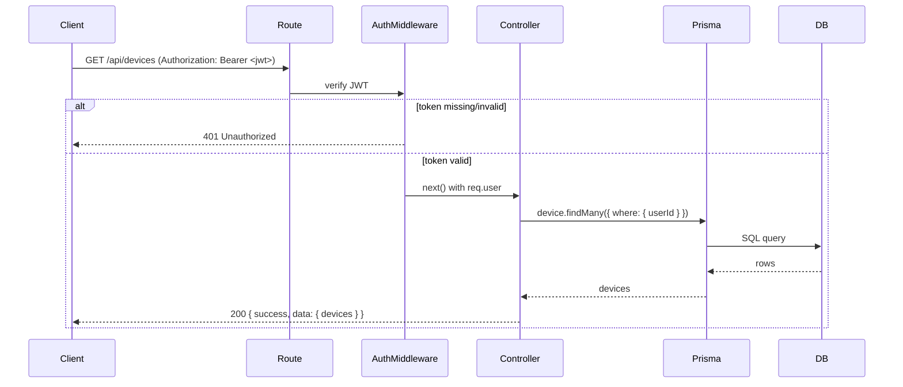
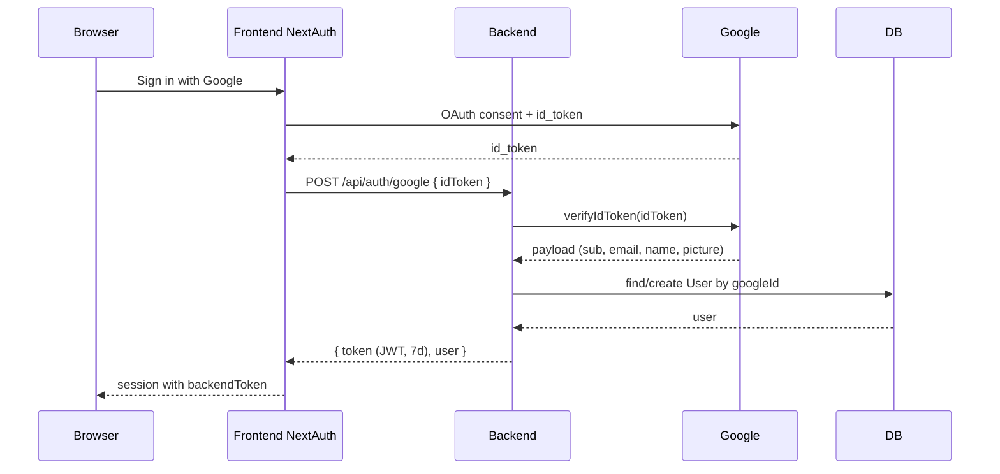
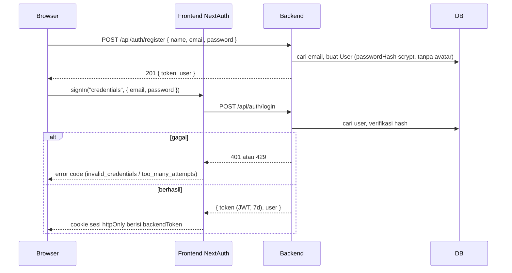
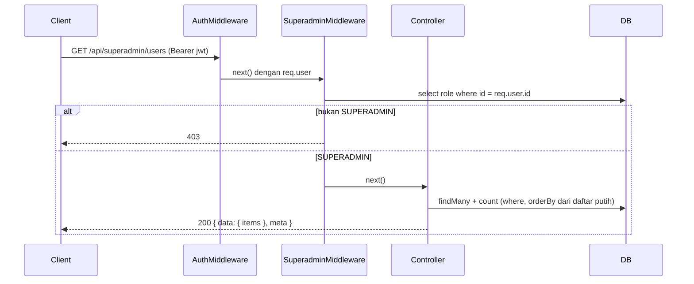
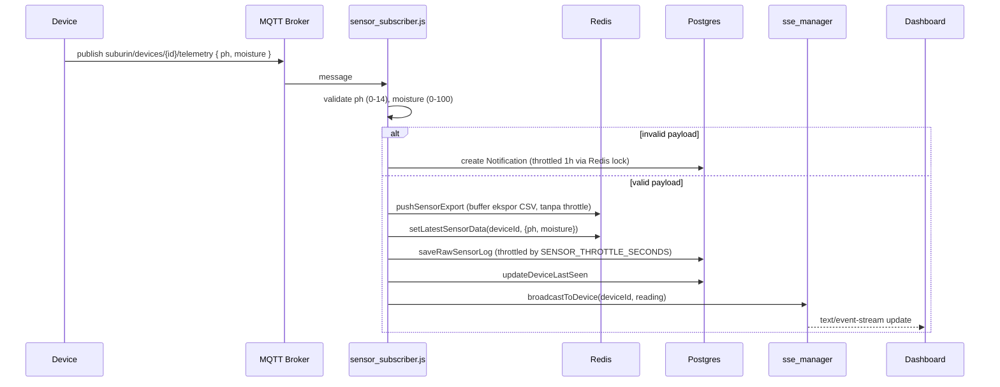
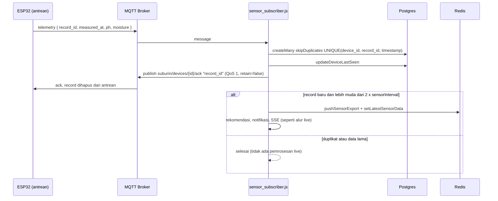
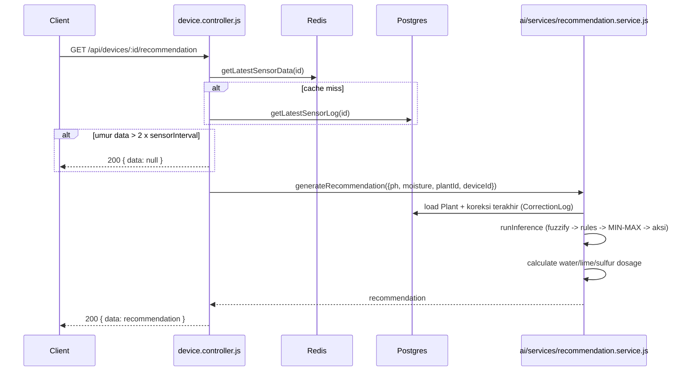

# Alur API

## Request REST terautentikasi

Sebagian besar endpoint memerlukan JWT yang diterbitkan oleh `POST /api/auth/login`, `POST /api/auth/register`, atau `POST /api/auth/google`, dikirim sebagai `Authorization: Bearer <token>` dan diverifikasi oleh [`auth.middleware.js`](../../backend/src/middlewares/auth.middleware.js).

## Google Sign-In

## Registrasi dan login email + password

Jika user yang mendaftar dengan email + password kemudian memakai Google dengan email yang sama, `POST /api/auth/google` menautkan `googleId` ke akun itu, mengisi avatar dari Google bila kosong, dan menghapus password lama ([ADR-009](../decisions/adr-009-email-password-auth.md)).

## Request Superadmin

## Telemetri perangkat (MQTT -> DB/Cache -> SSE)

### Antrean offline ESP32 (record bernomor + ACK)

Pesan yang membawa `record_id` (bilangan bulat) mengikuti jalur berbeda. Pesan tanpa `record_id` (firmware lama, Dev Mode) tetap memakai alur di atas.

Tanpa ACK, ESP32 mengirim ulang record tertua tiap 30 detik. `measured_at = null` berarti jam belum sinkron NTP (`time_synced=false`). Detail keputusan: [ADR-011](../decisions/adr-011-offline-queue-ack-and-export-buffer.md).

### Ekspor CSV

`GET /api/sensors/:deviceId/export.csv` otorisasi lewat `EXPORT_API_KEY` atau JWT pemilik, memetakan `deviceId` ke `deviceCode` di Postgres, lalu membaca list Redis `sensor:export:<deviceCode>` (bukan tabel `raw_sensor_logs`), menyaring `from`/`to`, mengurutkan menurut waktu, dan membalas `text/csv`.

## Pembuatan rekomendasi

Endpoint ini read-only: tidak menulis ke database. `recommendation_logs` hanya ditulis oleh subscriber MQTT (`mqtt/subscribers/sensor_subscriber.js`) untuk setiap pesan sensor yang valid.

Lihat [error-response.md](../api/error-response.md) untuk format error bersama dan [authentication.md](../api/authentication.md) untuk detail token.
