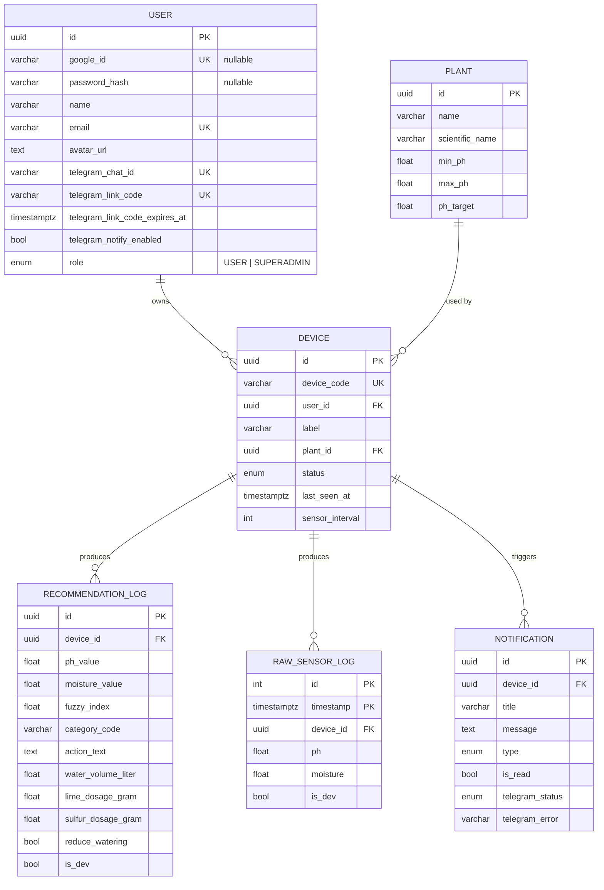

# Skema database

PostgreSQL (dihosting di Supabase), diakses melalui Prisma. Sumber skema: [`backend/prisma/schema.prisma`](../../backend/prisma/schema.prisma).

## Entitas

| Model               | Tujuan                                                                                       |
| ------------------- | -------------------------------------------------------------------------------------------- |
| `User`              | Akun pengguna, dibuat lewat email + password atau Google Sign-In; memiliki `role` (`USER`/`SUPERADMIN`) |
| `Device`            | Unit sensor IoT terdaftar, dimiliki oleh seorang user, terhubung ke sebuah plant    |
| `Plant`             | Data referensi spesies tanaman (rentang/target toleransi pH)                                 |
| `RecommendationLog` | Satu hasil rekomendasi fuzzy logic, terkait dengan sebuah device                             |
| `RawSensorLog`      | Telemetri pH/kelembaban mentah, dipartisi per bulan untuk retensi/pembersihan                |
| `Notification`      | Peringatan yang ditujukan ke user, terikat pada device (misalnya data sensor tidak valid)    |

## ERD

## Catatan

- `Device.id` adalah UUID surrogate key; kode fisik perangkat (yang dipakai topik MQTT dan provisioning hardware) disimpan di `Device.deviceCode` (`device_code`, unik).
- Relasi `Device` -> `Plant` menggunakan `onDelete: Restrict`: plant yang sedang digunakan oleh device tidak dapat dihapus, sehingga device tidak menjadi yatim (orphaned).
- `Device` -> `User` menggunakan `onDelete: Cascade`: menghapus user akan menghapus device miliknya (dan secara transitif juga recommendation log serta notifikasi terkait).
- `RawSensorLog` menggunakan kunci `(timestamp, id)` dan dipartisi berdasarkan rentang bulan di level database (dikelola oleh [`src/cron/database_cleanup_cron.js`](../../backend/src/cron/database_cleanup_cron.js)) agar penulisan telemetri berfrekuensi tinggi dan pembersihan retensi tetap murah.
- Enum `DeviceStatus`: `ACTIVE`, `INACTIVE`, `OFFLINE`. Enum `UserRole` (`user_role`): `USER`, `SUPERADMIN`. Enum `NotificationType` (`notification_type`): `warning`, `success`, `info`. Enum `TelegramDeliveryStatus` (`telegram_delivery_status`): `skipped`, `sent`, `failed`.
- `User.googleId` nullable karena akun yang dibuat lewat email + password belum tertaut Google. `User.passwordHash` (hash scrypt, lihat [backend/authentication.md](../backend/authentication.md)) nullable karena akun Google belum tentu punya password. Keduanya tidak pernah dikirim ke client.
- `User.role` default `USER`, `NOT NULL`, dan hanya diubah lewat Supabase Dashboard; tidak ada kode aplikasi yang menulisnya ([ADR-010](../decisions/adr-010-superadmin-role.md)).
- `RecommendationLog.isDev` dan `RawSensorLog.isDev` bernilai `true` hanya untuk data yang dibangkitkan Dev Mode, dan `false` untuk data dari sensor; nilainya ditentukan di `handleSensorMessage` (`isDev` hanya diteruskan oleh simulator Dev Mode).
- `RawSensorLog.recordId` (`record_id`, `text` nullable) adalah ID record teks dari antrean offline ESP32 (mis. `node_1-<hash>-1`), `RawSensorLog.moistureType` (`moisture_type`, default `legacy_index`) membedakan indeks lama dari `vwc_percent` (VWC dalam persen), dan `RawSensorLog.timeSynced` (`time_synced`, default `true`) bernilai `false` bila jam perangkat belum sinkron NTP (`timestamp` lalu berisi waktu terima). Unique index `uq_raw_sensor_logs_device_record (device_id, record_id, timestamp)` membuat penyimpanan ulang record yang sama idempoten; karena tabel dipartisi, kolom `timestamp` wajib ikut di index. Baris tanpa `record_id` (NULL) tidak saling bentrok. Dedup sebenarnya memakai `SensorRecordReceipt` (`sensor_record_receipts`, PK `(device_id, record_id)`, tidak dipartisi) yang ditulis satu transaksi dengan log, sehingga kirim ulang record ber-`measured_at` null tidak menggandakan baris. `RejectedSensorRecord` (`rejected_sensor_records`, unik `(device_id, record_id)`) menyimpan payload JSON asli dan `reason` untuk record yang gagal validasi, sebelum ACK dikirim. Lihat [ADR-011](../decisions/adr-011-offline-queue-ack-and-export-buffer.md).
- `User.telegramChatId` dan `User.telegramLinkCode` sama-sama bersifat nullable dan unik. `telegramLinkCode` adalah kode sekali pakai yang dihapus segera setelah webhook Telegram mengonsumsinya untuk mengisi `telegramChatId`. Lihat [api/telegram.md](../api/telegram.md).
- `User.telegramNotifyEnabled` (default `true`) mengatur perintah bot `/notifikasi on|off`; dibaca oleh `notifyDevice` untuk memutuskan apakah channel Telegram ikut dikirimi, terlepas dari `telegramChatId` sudah tertaut atau belum.

- Semua kolom waktu bertipe `timestamptz(6)` (`@db.Timestamptz(6)`), termasuk `created_at`, `updated_at`, `last_seen_at`, dan `raw_sensor_logs.timestamp`.
- Menghapus device atau akun juga menghapus `raw_sensor_logs` miliknya di dalam satu `prisma.$transaction` (tanpa FK, jadi tidak ikut cascade).

## Index

Semua index dideklarasikan dengan `@@index` di `schema.prisma` (wajib, karena `prisma db push` menghapus index yang tidak dideklarasikan):

| Tabel                | Index                                                 |
| -------------------- | ----------------------------------------------------- |
| `raw_sensor_logs`    | `idx_raw_sensor_logs_device_timestamp (device_id, timestamp DESC)`, unik `uq_raw_sensor_logs_device_record (device_id, record_id, timestamp)` |
| `sensor_record_receipts` | PK `(device_id, record_id)` |
| `rejected_sensor_records` | unik `uq_rejected_sensor_records_device_record (device_id, record_id)` |
| `plants`             | unik `uq_plants_name_normalized (lower(btrim(name)))`, dibuat lewat `014_plants_constraints.sql` (tidak dimodelkan Prisma) |
| `devices`            | `idx_devices_user_id`, `idx_devices_plant_id` |
| `notifications`      | `idx_notifications_device_created (device_id, created_at DESC)` |
| `recommendation_logs`| `idx_recommendation_logs_device_created (device_id, created_at DESC)` |

## Constraint (CHECK)

Dikelola lewat SQL manual [`prisma/manual/001_check_constraints.sql`](../../backend/prisma/manual/001_check_constraints.sql), tidak dimodelkan Prisma. Field Prisma tetap `String`/`Float`.

| Tabel                 | Aturan                                                                            |
| --------------------- | --------------------------------------------------------------------------------- |
| `notifications`       | `type` hanya 'warning', 'info', 'success' (selain dijaga enum `notification_type`) |
| `recommendation_logs` | `category_code` cocok `^C[1-9]$`; `ph_value` 0-14; `moisture_value` 0-100; `water_volume_liter`, `lime_dosage_gram`, `sulfur_dosage_gram` >= 0; `fuzzy_index` 0-8 |
| `raw_sensor_logs`     | `ph` 0-14; `moisture` 0-100 (berlaku di semua partisi)                            |
| `plants`              | `min_ph`, `max_ph` 0-14; `min_ph < max_ph`; `ph_target` di antara keduanya        |
| `devices`             | `sensor_interval > 0`                                                             |

`notifications.type` kini enum `notification_type` (dimigrasikan manual lewat `006_indexes_fk_enum.sql`, karena `db push` tidak bisa mengubah `varchar` ke enum tanpa risiko kehilangan data). `category_code` tetap `varchar` dengan CHECK.

## Row Level Security

RLS diaktifkan (tanpa policy, tanpa `FORCE`) pada semua tabel dan seluruh partisi `raw_sensor_logs` lewat [`002_row_level_security.sql`](../../backend/prisma/manual/002_row_level_security.sql). Backend memakai role dengan `BYPASSRLS` sehingga tidak terpengaruh. Partisi baru otomatis diaktifkan RLS-nya oleh `database_cleanup_cron.js`.

Lihat [database/prisma.md](../database/prisma.md) untuk konvensi query dan [database/migration.md](../database/migration.md) untuk cara perubahan skema diterapkan.
