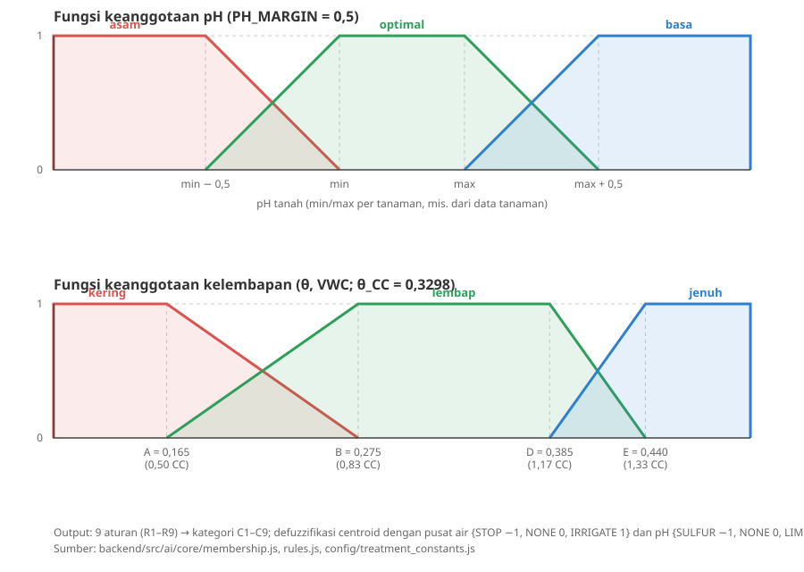

# Fuzzy logic

Dokumen ini menjelaskan mesin fuzzy di `backend/src/ai` setelah disesuaikan dengan dokumen perancangan **C501** ("Rancangan Fuzzy Mamdani dan Kalkulator Dosis Air Subur.in", Draf Final13). Alasan memilih metode ini ada di [ADR-004](../decisions/adr-004-fuzzy-logic-engine.md).

## Alur

```
Sensor (VWC) -> fuzzifikasi (pH, theta) -> rule base 3x3 -> Mamdani MIN-MAX
             -> centroid per sumbu (air, pH) -> kategori C1-C9 -> safety gate -> kalkulator dosis
```

Fuzzy hanya menentukan **jenis** tindakan. Besaran air/dolomit/sulfur dihitung kalkulator deterministik, dan safety gate menentukan apakah koreksi pH boleh ditampilkan sebagai instruksi.

| File | Peran |
|------|-------|
| `core/membership.js` | Fungsi keanggotaan pH dan kelembapan (VWC) |
| `core/rules.js` | Rule base 3x3, kategori C1-C9, pusat himpunan konsekuen |
| `core/engine.js` | MIN-MAX, centroid dua sumbu, ambang aksi, override |
| `core/safety_gate.js` | Pemeriksaan koreksi pH |
| `dosage/*` | Kalkulator air, dolomit, sulfur |
| `config/plant_moisture.js` | Pemicu/target kelembapan (persen VWC) untuk tampilan |
| `config/treatment_constants.js` | Semua konstanta desain |
| `services/recommendation.service.js` | Orkestrasi + akses database |

## Input

- **pH** (`0-14`).
- **VWC** (`moistureValue`, persen `0-100`, sama dengan `soil_vwc_pct`): kadar air volumetrik. Service membaginya 100 menjadi theta (m3/m3). Pembacaan indeks lama (`legacy_index`) tidak dipetakan ke VWC dan tidak menghasilkan rekomendasi.
- `safetyOverride` (opsional, string alasan, mis. `sensor_out_of_range`): memaksa air STOP tanpa mengubah nilai VWC (lihat Override pengaman).

## Parameter

Acuan kelembapan adalah container capacity polybag 2 L: `theta_CC = 0,3298` m3/m3 (659,6 mL / 2.000 mL). Semua tanaman memakai fraksi `theta_CC` yang sama; yang berbeda per tanaman hanya rentang pH (tabel `plants`).

| Tanaman | pH min | pH max | pH target |
|---------|-------:|-------:|----------:|
| Selada | 6,0 | 6,7 | 6,5 |
| Bayam (*Amaranthus*) | 6,0 | 7,0 | 6,5 |
| Pakcoy | 6,0 | 7,5 | 6,8 |

Tanaman lain ditolak `422`. Angka kelembapan adalah parameter desain, bukan optimum agronomi teruji.

## Fungsi keanggotaan



**pH** (`ASAM`, `OPTIMAL`, `BASA`; transisi 0,5 satuan di luar [min, max]) tidak berubah.

**Kelembapan** (`KERING`, `LEMBAP`, `JENUH`) dengan titik `a = 1/2`, `b = 5/6`, `d = 7/6`, `e = 4/3` kali `theta_CC` (0,1649; 0,2748; 0,3848; 0,4397):

- `KERING`: 1 untuk theta <= a, turun linear ke 0 di b.
- `LEMBAP`: naik a..b, 1 pada b..d, turun d..e.
- `JENUH`: 0 untuk theta <= d, naik linear ke 1 di e.

Ketiganya selalu berjumlah 1. JENUH baru aktif di atas 0,3848, di luar daerah kalibrasi sensor, sehingga pada data normal ia tidak tercapai; kondisi basah ditangani override.

## Rule base 3x3

| pH \ Kelembapan | KERING | LEMBAP | JENUH |
|----------|--------|--------|-------|
| ASAM | C5 | C4 | C6 |
| OPTIMAL | C2 | C1 | C3 |
| BASA | C8 | C7 | C9 |

Setiap kategori = `WaterAction` x `pHAction`:

| Kategori | WaterAction | pHAction |
|----------|-------------|----------|
| C1 | NONE | NONE |
| C2 | IRRIGATE | NONE |
| C3 | STOP | NONE |
| C4 | NONE | LIME |
| C5 | IRRIGATE | LIME |
| C6 | STOP | LIME |
| C7 | NONE | SULFUR |
| C8 | IRRIGATE | SULFUR |
| C9 | STOP | SULFUR |

## Inferensi (Mamdani, centroid per sumbu)

1. `alpha = min(mu_pH, mu_kelembapan)` per aturan.
2. Dua sumbu terpisah agar kode C1-C9 tidak diperlakukan sebagai jarak: air (`STOP -1`, `NONE 0`, `IRRIGATE +1`) dan pH (`SULFUR -1`, `NONE 0`, `LIME +1`).
3. Konsekuen berupa segitiga `max(0, 1 - |y - c|)` pada domain [-1, 1], dipotong `alpha` (MIN), diagregasi dengan MAX.
4. Centroid pada grid `dy = 0,02`: `y* = sum(y mu) / sum(mu)`.
5. `y* >= 0,12` menjadi aksi positif, `y* <= -0,12` aksi negatif, selain itu `NONE` (ambang desain; pembandingan memakai toleransi 1e-9).
6. `fuzzyIndex` pada response = kekuatan aturan tertinggi yang mendukung aksi terpilih, diambil yang terlemah dari kedua sumbu (0-1).

Akibatnya pemicu siram jatuh di theta ~0,2207 (66,9% `theta_CC`) dan sumbu pH menyala LIME pada pH <= 5,75 dan SULFUR pada pH >= 7,25 (bayam).

## Override pengaman

Dengan `safetyOverride`, kelembapan diperlakukan JENUH penuh: air STOP, volume 0 mL, pH tetap dihitung sebagai indikasi dan ditunda oleh safety gate. Response memuat `decisionSource: "safety_override"` dan `overrideReason`; tanpa override `decisionSource` bernilai `fuzzy`. Status ini bukan bukti kejenuhan fisik. Pemicunya (ADC di luar rentang kalibrasi, theta < 0, sensor tidak sehat) belum ada di backend; pemanggil yang menentukan.

## Kalkulator

Rumus mengikuti Bagian 4.8-4.9 dokumen C501 untuk media **2 L** (preset polybag 25x25 cm, `src/ai/config/polybag.js`).

| Kalkulator | Rumus | Batas |
|------------|-------|-------|
| Air | `Vneed = max(0, (0,2748 - theta) x 2.000)` mL | `min(Vneed, 0,10 x 2.000)` = maks. 200 mL per siram; hanya bila `WaterAction = IRRIGATE`, selain itu 0 |
| Dolomit | `1,3 x V x max(0, pH target - pH)` g | 1,4 g/L = 2,8 g per 2 L |
| Sulfur | `0,6 x V x max(0, pH - pH target)` g | 1,2 g/L = 2,4 g per 2 L |

Koefisien dan batas adalah estimasi berbasis literatur, belum diuji pada media Subur.in.

## Safety gate koreksi pH

Koreksi hanya `READY` bila semua terpenuhi; jika tidak `DEFERRED` dengan daftar alasan. Gate tidak mengubah kategori fuzzy. Ambang pH mengikuti sumbu fuzzy (tidak ada ambang tambahan).

- `WaterAction` bukan `STOP`.
- Minimal 2 pembacaan konsisten (`consistentReadings`; subscriber MQTT menghitungnya via Redis `sensor:ph_out_of_range:<deviceCode>` untuk pH di luar batas +/- 0,25; default `Infinity` untuk simulasi).
- Tidak dalam masa tunggu 7 hari setelah koreksi (dari `correction_logs` bila `deviceId` diberikan; dicatat lewat `POST /api/devices/:id/corrections`).
- pH di batas ukur probe (<= 3,5 atau >= 8,0): `NEEDS_CONFIRMATION`.

Bila koreksi tidak `READY`, `limeDosageGram`/`sulfurDosageGram` bernilai 0; estimasi mentahnya tetap ada di `_debug.limeDetail` / `_debug.sulfurDetail`.

## Batasan

- Kalibrasi ADC -> VWC (kubik) belum tervalidasi pada polybag (ADC saat CC = 950 belum konsisten dengan theta_CC = 0,3298). Rekomendasi air dari VWC sensor belum boleh dianggap operasional sebelum ADC saat CC diukur ulang.
- Alur masa pantau pH (median harian, dua hari berurutan, status PANTAU/REKOMENDASI/MASA REAKSI/EVALUASI/ESKALASI) belum diimplementasikan di backend; yang ada baru masa tunggu 7 hari dan syarat dua pembacaan konsisten.
- Dosis gram belum tervalidasi secara agronomis.

## Cara mencoba

```bash
cd backend
npx jest src/__tests__/ai        # oracle Bagian 4.11, safety gate, dan service
node src/ai/simulate.js          # simulator interaktif (butuh database terseed)
```
